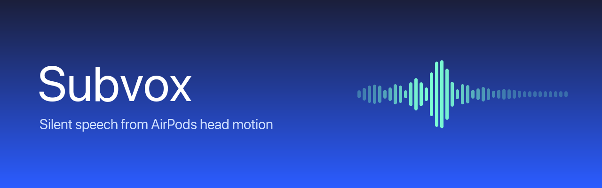

<p align="center"></p>

<p align="center">
<a href="https://github.com/Kahlus-Technologies/subvox/actions/workflows/ci.yml"></a>


</p>

A macOS prototype that tests whether AirPods Pro head-motion data (`CMHeadphoneMotionManager`) carries enough information to turn **silently mouthed words into text**.

It doesn't use a language model. It's a small-vocabulary template recognizer plus a statistical test that tells you whether the signal is real.

## Install

Grab `Subvox.dmg` from [Releases](../../releases) and drag Subvox into Applications. If macOS refuses to open it, that release is ad-hoc signed rather than notarized. Right-click Subvox and choose **Open** the first time.

To build the DMG yourself: `tools/make_dmg.sh` (needs `uv`, which fetches `dmgbuild`), output in `dist/Subvox.dmg`.

## Release

Bump `MARKETING_VERSION` in `project.yml`, then push a matching tag, for example `git tag v0.2.0 && git push origin v0.2.0`. The Release workflow runs `tools/make_dmg.sh` and attaches `dist/Subvox.dmg` to the GitHub Release for that tag. Pull requests that change the DMG files build it too and upload it as a workflow artifact.

Without the secrets below the DMG is ad-hoc signed. To notarize it, add these repository secrets (Settings > Secrets and variables > Actions):

| Secret | Value |
|---|---|
| `DEVELOPER_ID_P12` | The Developer ID Application certificate with its private key, exported from Keychain Access as a .p12, then base64-encoded (`base64 -i cert.p12 -o cert.txt`). |
| `DEVELOPER_ID_P12_PASSWORD` | The password chosen when exporting the .p12. |
| `NOTARY_APPLE_ID` | The Apple ID email of the developer account. |
| `NOTARY_TEAM_ID` | The 10-character Team ID. |
| `NOTARY_PASSWORD` | An app-specific password for that Apple ID, made at account.apple.com. |

To notarize on your own Mac, save the notary credentials once with `xcrun notarytool store-credentials subvox-notary --apple-id ... --team-id ... --password ...`, then run `DEVELOPER_ID="Developer ID Application: Your Name (TEAMID)" NOTARY_PROFILE=subvox-notary tools/make_dmg.sh`. The script then signs the app with the hardened runtime and `Subvox/Subvox.entitlements` (microphone access), and notarizes and staples the DMG.

## Build & run

```sh
brew install xcodegen   # once
xcodegen generate
open Subvox.xcodeproj   # ⌘R
```

Or from the command line:

```sh
xcodebuild -project Subvox.xcodeproj -scheme Subvox -derivedDataPath build test
open build/Build/Products/Debug/Subvox.app
```

Builds are ad-hoc signed by default, so no Apple account is needed. To sign with your own team, put your settings in a gitignored `Local.xcconfig` next to `Signing.xcconfig` (the format is in that file's comments). macOS may ask for Motion and Microphone permission again after a rebuild, because each ad-hoc build has a new signature.

Requires macOS 14+, AirPods Pro or another headphone that supports head tracking, connected as the Mac's audio output. On first launch, grant **Motion**. The mic and speech prompts only appear when you start the mic.

## Screens

| Screen | What it does |
|---|---|
| **Sensors** | Live plots of user acceleration, rotation rate and attitude, the measured sample rate, a mic input picker and level meter, and a recorder for experiment sessions. |
| **Train** | Pick a word, hold **Space**, mouth it, release. Each take is stored as a template. **Evaluate** runs leave-one-out classification and a 500× label-permutation test, then shows accuracy against chance, a p-value and a confusion matrix. The feature checkboxes (acceleration / rotation / attitude) let you test which channels carry the signal. **Quick setup** walks a new user through the six command words (yes, no, next, back, play, stop), 5 auto-captured takes each, in about 2 minutes. Its takes are added to any you already have; Cancel deletes the takes from that run. |
| **Decode** | The motion-to-text screen. Hold Space, or use auto-detect after calibrating the noise floor. Each segment is DTW-matched against your templates and added to the transcript. A live mic transcript runs alongside it for comparison. The **Media keys** switch (off by default) makes "play" and "stop" press Play/Pause, "next" Next Track and "back" Previous Track. macOS needs Subvox allowed under Privacy & Security > Accessibility for that. |

## How decoding works

1. **Segmentation** (`CaptureController`). Space-hold, or an energy trigger above a calibrated noise floor with pre-roll and hangover.
2. **Features** (`MotionFeatures`). Per frame: user acceleration (3), rotation rate (3), and attitude change since the start of the segment (3). Each channel is mean-centered, and quiet lead-in and lead-out frames are trimmed.
3. **Matching** (`DTW`, `TemplateClassifier`). Each channel is z-scaled across the training set. Matching is 1-nearest-neighbour per word, using dynamic time warping with a Sakoe–Chiba band. A segment is rejected if the best distance is above *max distance* or the margin to the runner-up is below *min confidence*.
4. **Is it real?** (`Evaluation`). The leave-one-out accuracy is compared with the same procedure run on shuffled labels. If p < 0.05, the motion stream distinguishes your words better than chance.

## Experiment protocol

Use **Record Session** in the toolbar or on the Sensors screen. Recordings go to `~/Documents/Subvox/Sessions/<timestamp>-<condition>/`:

- `motion.csv`: every motion sample. `t` is seconds from session start.
- `audio.caf`: microphone audio, if the mic is running.
- `events.csv`: every Space-held segment, with its label or prediction.
- `meta.json`: condition, prompt, and the audio start offset for aligning audio with motion.

Suggested runs: the same 5-word script under **Normal speech**, **Whisper** and **Silent mouthing**, 10 reps each. Then, in Train, compare the Evaluate results across feature sets.

The training set lives at `~/Library/Application Support/Subvox/dataset.json`.

## Known limits

- Headphone motion is processed and low-rate (about 50 Hz on AirPods Pro). The speech-detecting accelerometer and the inward mic are not exposed. Expect jaw and head movement, not vocal vibration.
- Templates are user- and session-specific. Re-seating the AirPods can shift the signal.
- Choosing AirPods as the mic input switches them to the Bluetooth headset (HFP) profile.

## Repo layout

| Path | What |
|---|---|
| `Subvox/` | The SwiftUI app (motion, audio, decoding, recording, views). |
| `SubvoxTests/` | Unit tests. |
| `analysis/` | Offline scoring scripts (`score.py`, `clean_test.py`, `dist_check.py`, `reseat.py`, `proto_net.py`). They read the app's `dataset.json` (or `--dataset PATH`) and need `numpy` and `numba` (`analysis/requirements.txt`). `proto_net.py` also needs `torch` (`analysis/requirements-ml.txt`). `open_vocab.py` reads session folders instead and runs the open-vocabulary baselines (#11); its CTC model needs `torch` too. `sh analysis/smoke_test.sh` runs them on small synthetic datasets. Results and commands are in `analysis/RESULTS.md`. |
| `tools/` | Session labeling with Phonon-2 and the DMG builder. |
| `dmg/` | DMG window background and `dmgbuild` settings. |
| `docs/` | README banner. |
